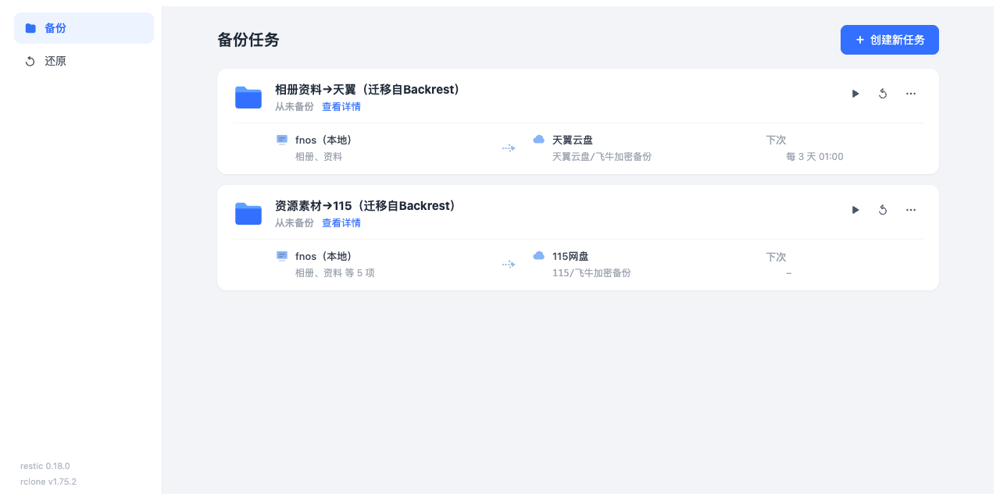
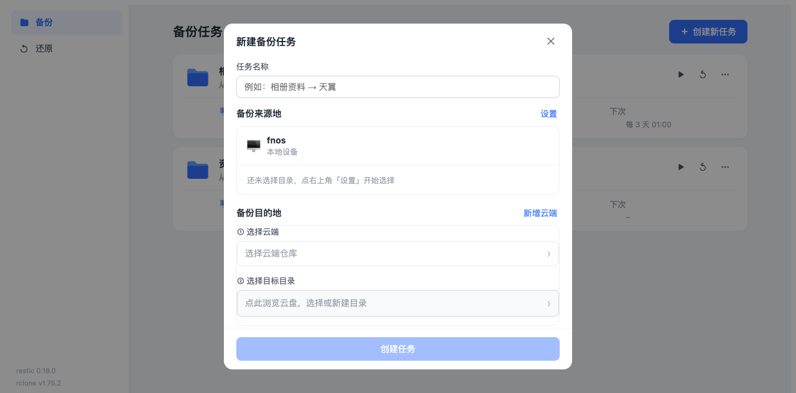
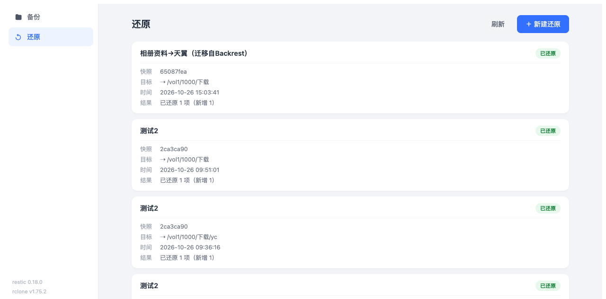
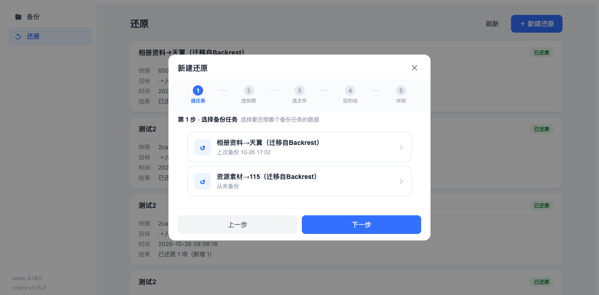

# BackVault

基于 [restic](https://restic.net/) 的**飞牛（fnOS）加密备份应用**。向导式创建备份任务，定时加密备份到云盘（天翼云盘 / 115 网盘 / OpenList 挂载的任意 WebDAV），支持可视化浏览快照与精确还原。

> 一款为 NAS 打造的自托管、端到端加密的备份与还原工具。数据在本地用 restic 加密后再上传云端，云端只存放密文。

## 功能特性

- 🔐 **加密备份**：restic 仓库，密码随机生成，数据先加密后上传，云端无明文
- ☁️ **多云盘支持**：天翼云盘 / 115 网盘 / 任意 WebDAV（OpenList 挂载）作为远端仓库
- 🗓 **定时调度**：内置调度器，按「每 N 天 / 每周 / 每日」周期自动备份
- 📊 **进度可视化**：备份任务卡片内嵌进度条（开始时间、已处理数据量），无需依赖 restic 原生日志
- 🧾 **日志精简视图**：restic 海量后台日志解析为关键节点时间轴 + 一行结果
- 🕐 **快照时间线**：可视化浏览历史快照，含相邻快照差异徽章（新增/修改/删除）
- ♻️ **精确还原**：五步向导（选任务 → 选快照 → 选文件 → 选目的地 → 冲突策略），文件树逐层下钻、目录整选
- 🖥️ **双端适配**：桌面左侧导航 + 任务卡片；手机顶部 Tab + 底部抽屉
- 📦 **双形态部署**：fnOS fpk 应用包 + Docker 镜像

## 界面预览

### 备份任务



向导式创建备份任务，任务卡片内嵌来源 → 目标流向与调度信息：



### 还原

还原历史列表，每条记录展示快照 / 目标 / 时间 / 结果：



五步还原向导（选任务 → 选快照 → 选文件 → 选目的地 → 冲突策略）：



## 技术栈

| 层 | 技术 |
|---|---|
| 后端 | Go（标准库 + `net/http`），Unix Socket 走 fnOS 统一网关 |
| 前端 | Vue 3 + Vite（无 UI 框架，纯手写组件） |
| 备份引擎 | restic 0.18 + rclone（stdio 后端） |
| 打包 | fnpack（fpk）+ Docker |

## 目录结构

```
encbackup-app/
├── backend/            # Go 后端（main.go，单文件）
│   ├── main.go
│   └── go.mod
├── frontend/           # Vue 3 前端
│   └── src/App.vue     # 主组件（含全部页面逻辑）
├── encbackup/          # fpk 应用包布局
│   ├── app/server/     # 后端二进制 + engines（restic/rclone）+ public（前端产物）
│   ├── cmd/main        # 生命周期脚本（start/stop/status）
│   ├── config/         # privilege / resource
│   ├── manifest        # 应用元信息
│   └── wizard/         # 安装向导（占位）
├── scripts/            # 工具脚本（gen_icons.py）
├── design/             # UI 设计预览 HTML（方案稿）
├── mock-*.html         # 交互 mock 预览
├── build.sh            # 一键构建脚本
├── Dockerfile          # Docker 镜像
└── docker-compose.yml  # Docker Compose 示例
```

## 快速开始

### 方式一：Docker 部署（推荐，跨平台）

```bash
# 1. 准备备份源目录，例如 ./backup-src
mkdir -p backup-src data

# 2. 修改 docker-compose.yml 里的 AUTH_PASS 为强密码

# 3. 构建并启动
docker compose up -d --build

# 4. 浏览器访问 http://主机IP:5175，用 AUTH_USER/AUTH_PASS 登录
```

### 方式二：fnOS fpk 应用包

```bash
# 1. 下载 restic / rclone 的 linux/amd64 二进制到 /tmp/encbin/
mkdir -p /tmp/encbin
#    restic:  https://github.com/restic/restic/releases
#    rclone:  https://github.com/rclone/rclone/releases
cp restic rclone /tmp/encbin/

# 2. 一键构建（前端 → Go 后端 → 组装 → fnpack 打包）
./build.sh

# 3. 产物 encbackup.fpk，在飞牛应用中心安装
```

> 构建需要：Node.js、Go、`fnpack` 工具（`../tools/fnpack`，或自行安装）。

### 本地开发

```bash
# 前端
cd frontend && npm install && npm run dev

# 后端（默认 Unix Socket 模式；本地调试可用 HOST/PORT 走 TCP）
cd backend && go run .
```

后端环境变量：

| 变量 | 默认 | 说明 |
|---|---|---|
| `HOST` / `PORT` | `0.0.0.0` / `5175` | TCP 监听（Docker 模式） |
| `TRIM_PKGVAR` | `./var` | 数据目录（config.json、日志、缓存） |
| `TRIM_APPDEST` | `.` | 应用安装目录 |
| `USER_ROOT` | `/vol1/1000` | Web 界面「我的文件」根目录 |
| `AUTH_USER` / `AUTH_PASS` | 空 | 非空时启用 HTTP Basic Auth |
| `ENGINES_DIR` | — | restic/rclone 二进制目录（Docker 用） |

## 架构说明

```
┌─────────────┐     ┌──────────────────┐     ┌──────────────┐
│   Web UI    │────▶│  Go 后端（网关）  │────▶│  restic CLI  │
│  (Vue 3)    │     │  net/http + Unix │     │  (stdio→rclone)│
└─────────────┘     │  Socket          │     └──────┬───────┘
                    └──────────────────┘            │
                                                    ▼
                                          rclone（WebDAV）
                                                    │
                                                    ▼
                                          天翼 / 115 / OpenList
```

- **加密链路**：restic 本地加密 → rclone stdio 后端 → WebDAV → 云盘。云盘只存密文。
- **调度**：后端内置定时器，备份任务按 cron 周期触发，进度经 restic JSON 输出解析。
- **还原**：浏览快照 → 浏览文件树（逐层下钻）→ 指定原位置或新路径 → 冲突策略 → 执行。

## 安全说明

- 仓库密码随机生成，仅存于本地数据目录（`TRIM_PKGVAR/config.json`），不上传云端
- 云盘 WebDAV 凭证仅存于本地 `rclone.conf`
- 请勿将本地数据目录（`data/`、`backup-*/`）提交到版本库或泄露，其中含真实凭据

## License

[MIT](./LICENSE)
